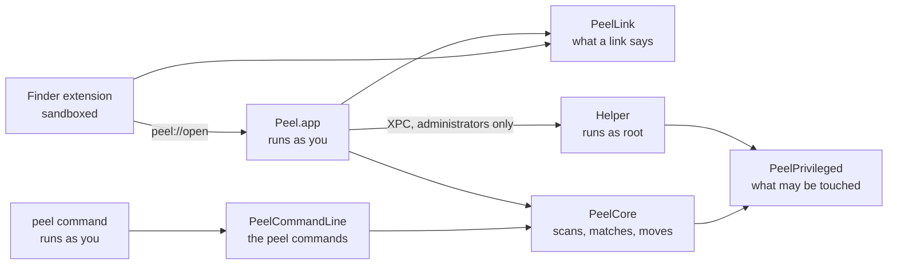

# How Peel is built

This page is for anyone who wants to read or change Peel's code. It describes the parts, how a removal travels
through them, and the few ideas that hold the whole thing together. [AGENTS.md](AGENTS.md) has the rules a change
has to keep, [CONTRIBUTING.md](CONTRIBUTING.md) how to propose one, and [SAFETY.md](SAFETY.md) the full list of what
Peel protects.

## The parts

Peel is four programs built from one Xcode project, and a Swift package that holds almost all of the logic.

| Part | Folder | Runs as | What it does |
|---|---|---|---|
| Peel.app | `Peel/` | You | The SwiftUI app: every page, and a model for each. |
| The helper | `PeelHelper/` | root | A launch daemon for the few things only an administrator can do: move items to the Trash and back, and start, stop, enable, or disable another vendor's launch daemon. |
| The Finder extension | `PeelFinder/` | You, sandboxed | Adds Uninstall with Peel to the menu Finder shows when you Control-click an app, and opens Peel with `peel://open?path=`. |
| The `peel` tool | `PeelCLI/` | You | The command-line tool, shipped inside `Peel.app/Contents/Helpers`. |

The package, `Packages/PeelCore`, has four libraries:

- **PeelCore** decides and acts: it finds apps and their leftovers, measures folders, matches files to apps,
  and moves things to the Trash. It has no pages or windows, only three pieces of interface the app's lists and
  sheets use (`RowCheckboxButton`, `SheetInFront`, `TextEditing`), and it speaks plain English: the app words
  everything a person reads in Peel, and `PeelCommandLine` what `peel` prints.
- **PeelPrivileged** is the part the helper shares: which paths may be touched, what is protected, how a tool
  is run, and how a path is split into names. The helper links nothing else, so it stays small.
- **PeelCommandLine** holds the `peel` commands. `PeelCLI` is only their entry point.
- **PeelLink** says what a `peel://open?path=` link means, for the Finder extension that sends it, the
  notifications that send it too, and the app that reads it. The extension links nothing else.

Keeping the logic in the package is what makes it testable: `swift test --package-path Packages/PeelCore` runs
more than 2,200 tests without building the app.

## Where to start reading

- `Peel/PeelApp.swift`: the app's entry point, its windows, and the menu bar panel.
- `Peel/Navigation/`: the sidebar and the tools it lists (`ToolSidebar`, `Tool`), the menu commands
  (`PeelCommands`), and the App Shortcuts (`PeelShortcuts`).
- `Peel/Views/ContentView.swift`: the main window, its sidebar, and how a page is chosen.
- `Packages/PeelCore/Sources/PeelCore/Removal/Uninstallation.swift`: what an uninstall offers, and what it selects
  for you.
- `Packages/PeelCore/Sources/PeelCore/Leftovers/LeftoverScanner.swift` and `LeftoverMatcher.swift`: where leftovers
  are looked for, and how each one is judged.
- `Packages/PeelCore/Sources/PeelCore/Removal/TrashService.swift` and `RemovalGuard.swift`: how an item moves to the
  Trash, and what is refused.
- `Packages/PeelCore/Sources/PeelPrivileged/ProtectedData.swift` and `PrivilegedPathPolicy.swift`: what nothing may
  remove, and what the helper may touch.
- `PeelHelper/HelperService.swift`: the helper's operations.
- `Packages/PeelCore/Sources/PeelCommandLine/PeelCommand.swift`, which registers the `peel` commands kept in
  `Commands/`, and `Support/Cleanup.swift`, the one path every command that removes what a scan found goes through.

## How a removal travels

Take the most common case, uninstalling an app. Every other page that moves something to the Trash follows the same
path with its own scanner; iCloud Drive's Remove Downloads only asks iCloud to drop this Mac's copy of a file, and
the Homebrew page's uninstall and cleanups are Homebrew's own.

1. **Scan.** `Uninstallation.prepare` asks `LeftoverScanner` to look through every place an app keeps files
   (`SearchLocation`): Application Support, Caches, Containers, Preferences, launch agents, plug-in folders, the
   top of the home folder, and more. It adds the paths the app's Homebrew cask names in its `uninstall` and `zap`
   stanzas, whether or not Homebrew installed the app (`CaskEvidence`); the installer receipt that proves the app,
   its two files in `/private/var/db/receipts`, while what the package installed stays with the Package Receipts
   page, which lists it only while the receipt is there, so a receipt whose package left more outside the app is
   held back; the cask's own folder in Homebrew's Caskroom when Homebrew installed it (`HomebrewPackage.caskroomFolder`);
   and what an area the app manages keeps in the home folder, such as Xcode's simulators. A page's scan runs
   through its `ScanRun`, so a newer scan or the Stop button ends an older one, and it counts what it reads so the
   page can show progress.
2. **Match.** For each file, `LeftoverMatcher` weighs the evidence that it belongs to the app: its bundle
   identifier, the identifiers of what the app embeds, its application groups, its signing team, and its name. A
   plug-in and a container named by a UUID are also weighed by the identifier they declare: a plug-in's name says
   what it does and a UUID says nothing, so the identifier decides whose they are. A launch job is weighed by the
   program it runs, since anyone can name its file: a job that runs a program inside the app is the app's, and one
   that runs a program inside another installed app is that app's. What macOS keeps for its own services under a
   plain name directly in a Library folder, such as `Application Support/Knowledge`, is no app's, whatever app is
   called by that name (`SystemFolders`). The answer is a `LeftoverMatch`: a confidence
   (`certain`, `likely`, or `possible`), the reason, the other installed apps that claim the file too (with the apps
   of the same maker that macOS knows outside the Applications folders, the apps Peel saw installed before, whose
   identifiers stay theirs once they are gone, and, for a file only the app's name claims, another maker's app whose
   name holds that name as whole words; a file tied to the app only by its maker's identifier or team, and named for
   another app of that maker that macOS knows anywhere, such as a build, is not listed), the other copies of the app
   that use it (any macOS knows, wherever they are, named by their place), and, when Peel holds it back, why
   (`HoldBack`).
3. **Measure.** `FileSize` walks each folder on a thread of its own, with a time budget. A size is what moving
   the item would free: a file that shares its blocks with an APFS clone counts only what it holds alone, and one
   with another name outside the folder counts nothing. A folder that doesn't answer in time, or that macOS won't
   open, even a folder inside it, has an unknown size, never zero, and every list shows it that way.
4. **Plan.** The page shows every match with its reason. Only `certain` and `likely` matches that nothing else
   claims are selected for the user (`Uninstallation.suggestedSelection`), and nothing is selected for an app
   that would stay. The user can change the selection freely, and what they choose stays through the page's
   later scans and as the helper comes and goes: `KeptSelection` keeps the checkbox of every row they could
   already choose and gives Peel's suggestion only to a row they could not, and every page that selects for the
   user and scans again on its own keeps its choices by it. Among several apps, one whose bundle the user
   deselects stays, and its files leave the selection with it (`UninstallSelection`).
5. **Move.**
   - The question before the move freezes what it asks about, and the move takes exactly that
     (`RemovalQuestion`, which also runs one removal at a time and holds the page's scans until it is over).
   - Before any of it, the app has to quit, and Peel offers Force Quit when it doesn't (`QuitBeforeRemoving`).
     When the app had to quit, its page scans again before asking, since what it wrote until then was not there
     when the page scanned.
   - The app moves first, and its files follow only once it has moved, so an app that stays keeps everything of
     its own (`TrashService`'s
     `trash(apps:thenFiles:usingHelperFor:lettingTheirProgramsRun:emptiedFoldersNamed:)`, which an app's page,
     several apps' page, Remove Peel, and `peel uninstall` share). A folder named for the app or its maker that the
     move leaves empty goes with them, unless macOS keeps it under that name for its own services (`MakersFolders`).
   - `TrashService` asks `RemovalGuard` about each item first, holds the folder around the item open, asks again
     about what the kernel calls that folder, and moves the item through it, so the thing judged is the thing
     moved. Items only an administrator can move go through the helper, and the links an app's tools and their
     shell completions left in `/usr/local` go last, once the app they lead into has moved. A browser's manifest in
     `/Library` goes through the helper too, which takes it only once the program it names is gone.
   - An item stays where it is while a program holds it (`OpenFiles`): a file one of the user's programs holds
     open, the program any process runs from it, or a script in it a program such as Node.js was given to run.
     When only an app's own background programs hold it, the move stops their launch jobs, moves the app, and
     starts each job again unless its file went to the Trash too.
     Inside an app, which is code and loses nothing when it moves, a file open only for reading holds nothing, and
     neither does the program running from an app that uninstalls itself once it has moved (`UninstallsItself`:
     Mullvad VPN's daemon, and Citrix Workspace's agent and TeamViewer's daemon, each known by the `WatchPaths` of
     its job file), whose uninstaller's files are held back (`leftToItsUninstaller`) rather than moved first.
   - What Peel itself runs from never moves, nor anything holding it, such as the folder a copy built from source
     runs from: only Remove Peel moves Peel (`TrashFailure.Reason.peelRunsFromIt`).
   - An app carrying a system extension macOS installed is left to Finder (`RemovedElsewhere.byFinder`): Finder's
     move asks macOS to remove the extension and Peel's would not, so Peel moves nothing of the app, on its page,
     among several apps, on the Package Receipts and Homebrew pages, and in `peel uninstall` alike
     (`AppExtensions.installed(carriedBy:asking:)`, which also says whether System Settings deletes every one:
     `AppExtension.systemSettingsDeletesIt`, a network extension on macOS 27, by the category `systemextensionsctl`
     lists it under).
   - A security or management agent, or a VPN, whose maker removes it with an uninstaller of its own is left to that
     uninstaller (`RemovedElsewhere.byItsMaker`, `MakersUninstaller`), and so is an uninstaller app its maker
     documents, such as Chrome Remote Desktop Host Uninstaller. Each is known by its checked signing team and the
     identifier its maker documents or signs; its page names the maker's step, opens the app whose own command removes
     it, or points to the uninstaller on the app's disk image, and links the instructions, nothing of it is selected or
     moved, and `peel uninstall` refuses it.
   - A program another account runs, root's included, can't be quit by the person or by Peel (`kill(2)` answers
     `EPERM`), so it is never in the question to quit apps (`RunningCopies.Process.mayBeQuit`), and what it runs
     from stays with a reason of its own: `openForAnotherUser` when it is another user's of this Mac (an account
     from 501, read with `sysctl`), who can quit it in their own account, and `heldByAnotherAccount` for the system's
     own services, as does an item only macOS's own programs hold (`inUseByMacOS`), since nobody quits those.
     `OpenFiles.refusal(heldBy:)` is the one rule.
   - The app's privacy permissions are reset, when that was chosen, just before the move and only once the
     checks the move makes first (the guard, History, and the programs holding it) say it will go
     (`PrivacyReset`).
6. **Finish.** Only for what really moved: the launch jobs whose files went are stopped, macOS is told to
   forget the preference domains whose files went, and an uninstalled app's Dock icon comes out (`DockTiles`),
   unless Also remove from the Dock was turned off, or `peel uninstall` was given `--keep-in-dock`. On macOS 27,
   an app's page and several apps' page also say when macOS still starts the app's login items at login, now from
   the Trash, until the Trash is emptied (`TrashResult.startsFromTheTrash`). Both pages, and `peel uninstall`, also
   name the lines of the shell startup files that still point to what moved, such as a `PATH` entry into the app
   (`ShellReferences`, which reads the files zsh, bash, and fish start with and never changes them).
7. **Record.**
   - Every removal goes into History (`removals.json`, through `RemovalLog`), with where each item came from and
     where it went, so it can be put back; History keeps the most recent 20,000 items, fewer when their paths are
     very long, since it never writes more than it reads back (`Batches.fitting`). A removal is one entry, even when
     it moved what was selected on several pages.
   - As it records, History adds what moved to the totals Home and the menu bar panel show (`totals.json`, through
     `RemovalTotals`), so the app and `peel` count alike.
   - Each item is also written down the moment it moves, and what the helper moves as soon as it answers each
     request (`removals.journal`, through `RemovalJournal`), so what a removal moved before it was cut short reaches
     History the next time History is read, as an interrupted removal, or as what it was when History couldn't write
     it, since its line then keeps the record (`RemovalJournal.keep`). Quitting the app waits for a removal until
     History has it (`QuitGuard`), as `peel` carries on through Control-C (`Uninterrupted`).
   - While History cannot be read nothing moves (`RemovalLog.canBeRead`, asked by `TrashService` before a removal)
     until Start Over, on the History page, sets the unreadable file aside, and while it cannot be written, its folder
     closed or its disk without room for the copy a safe write makes, nothing moves either (`RemovalLog.canBeWritten`).
   - What Peel refused to move is recorded too (`refusals.json`), and History lists it under Not Moved, one
     removal to an entry.
   - What only an administrator can move, from a place the helper doesn't serve, stays where it is, and once the
     app has moved, an uninstall records it (`left-for-an-administrator.json`, through `LeftForAnAdministrator`),
     so Orphaned Files lists it under Needs an Administrator, judged again as its scan judges what it finds.
8. **Put back.** History's Put Back reads its record as a request, not as a fact: an item returns only from a
   real Trash, only to a place the guard allows, only when it is the item that went (`TrashedItem.identity`,
   its inode and birth time, read in the Trash as it landed and asked again of the item Put Back holds open),
   and, through the helper, only if the helper's own ledger says it moved that very item from that very place.
   When Peel puts an item back itself, the folders gone on the way are made again through descriptors, never through
   a link, once the guard has allowed the place, and are taken away again if the item then stays in the Trash; the
   helper puts an item back only into a folder that is still there, so Put Back says first when that folder is gone.
   An app that comes back gets its Dock icon back where it was, a launch job the move stopped starts again as the
   file back in place declares it, and the apps put back are made known to Launch Services again only once every
   item is back.

## What keeps data safe

A handful of ideas carry most of the weight. Each is enforced in one place and tested there.

- **The Trash, never deletion.** Nothing in Peel deletes anything of the user's. What it deletes outright holds
  nothing of theirs: the empty placeholder `TrashMover` makes to hold a name on a disk that cannot rename without
  replacing (exFAT), when the move it was made for fails; the folder `PreferenceBackup` makes for a reset's saved
  settings, when saving fails while it is still empty; the folders Put Back makes on the way back
  (`DirectoryHandle.child(_:makingIfMissing:)`), when the item then stays in the Trash and each is still the empty
  folder it made; and the empty file cfprefsd writes back where a moved settings file was when `PreferenceCleanup`
  forgets a domain it still holds, which would keep History from putting that file back. Peel's list of refusals, with
  any copy of it set aside because it couldn't be read, goes to the Trash when `peel history --refused --clear` asks.
  Four actions can't be undone by History, and each says so
  where it is confirmed: Homebrew's own uninstall and cleanups, resetting an app's privacy permissions, and Force Quit
  for an app that is still open 10 seconds after Peel asked it to quit (`QuitBeforeRemoving`). Moving Mullvad VPN,
  Citrix Workspace, or TeamViewer starts that app's own uninstaller, which deletes what History can't bring back, and
  Peel says so before it moves them (`UninstallsItself`). Forgetting a preference domain happens only once its file is
  in the Trash, so putting the file back undoes it, or, when saved settings are put back, once the settings in use are
  saved as a copy of their own (`PreferenceBackup`). Every `brew` call runs without Homebrew's automatic cleanup
  (`HOMEBREW_NO_INSTALL_CLEANUP`), so an upgrade never deletes on its own; when a `brew.env` file of the user's turns
  that back on (`Homebrew.overrides()`, from `brew config`), the Homebrew page says so and leaves upgrades to
  Terminal.
- **One guard.** `RemovalGuard` decides, for the app and the `peel` tool alike, whether an item may move. Its
  list of what nothing can bring back lives in `ProtectedData`, in PeelPrivileged, so the helper applies the
  same list without asking the app. The guard judges the item and not the spelling of its path: each rule is
  asked of the path as written, as found on disk, and as the kernel names the item, and the places it protects
  by path (in the home, the keychains, and the folders that stay themselves) are known by device and inode as
  well, wherever a link leads them. It finds those places without opening them, since opening a folder inside
  another app's container makes macOS ask for that app's data. A path is read name by name (`PathComponents`),
  never as text, since a slash and a combining mark after it are one Swift `Character`. The guard also refuses
  anything that syncs to other devices (`SyncedFolders`): what iCloud or a File Provider keeps, and what sits in a
  folder Syncthing, Resilio Sync, Synology Drive Client, MEGA, or Dropbox outside File Provider keeps in step, since
  the Trash would take it from those devices too. It looks a level or two inside a folder for a library, a wallet, or
  work kept only in a cache, and refuses a folder holding a folder macOS won't let Peel list, unless only the helper can
  move it, which looks inside as root (`ProtectedData.Finding`).
- **Exclusions everywhere.** The user's exclusions reach every scanner, so an excluded item never appears, and
  a folder with something excluded inside is never moved, nor one Peel can't look into for an excluded app, since the
  helper knows nothing of the exclusions.
- **Unknown stays unknown.** A size that couldn't be measured, a list a tool didn't give, an answer that didn't
  come, whether an item is still in the Trash when macOS won't let Peel look (`TrashedItem.standing`): each is
  kept as not known, shown as such, never selected for the user, and never forgotten from History.
- **Every hold back has a reason.** When Peel takes a checkmark away, the row says why.

## The helper

The helper (`com.tuguidragos.Peel.Helper`) is registered with `SMAppService` when the user asks for it, and
macOS asks the user to approve it once. It talks to the app over XPC.

- Only an administrator installs, repairs, or uninstalls it. macOS lets any account unregister a daemon, so the app
  asks again at that moment whether this account is an administrator (`PrivilegedHelper.changeAsAnAdministrator`),
  and Remove Peel, from an account that isn't, leaves the helper and Peel where they are.
- It answers administrators only, asked when a connection opens and again with each message, and it accepts
  only a copy of Peel signed by the same team and no older a build than itself, checked when a connection opens
  and for every message after it.
  A released helper refuses a build that can be debugged, and launchd starts the helper only as the team's own
  build of it (`SpawnConstraint` in its launchd property list).
- Its calls are declared by `PeelHelperProtocol`, in
  `Packages/PeelCore/Sources/PeelPrivileged/HelperInterface.swift`, and the app reaches them through
  `PrivilegedHelper`, which first asks whether the helper answers, within 15 seconds, and waits at most 120 seconds
  for a request. Every request passes `HelperRequest.admit` before any work: the protocol version, at most 100 items,
  no path longer than macOS allows, and then the account behind it.
- It does three things: moves items to the Trash, puts them back, and starts, stops, enables, or disables another
  vendor's launch daemon, never one macOS ships and never itself. When Peel is removed, it also moves its own ledger
  to the Trash.
- It serves a fixed list of folders (`PrivilegedPathPolicy`), refuses everything else, and refuses whatever
  `ProtectedData` protects. It has no shell.
- It opens folders by descriptor and works through them, so a path swapped for a link after the check leads
  nowhere.
- It keeps a ledger of what it moved, in a folder only root can write (`/private/var/db/com.tuguidragos.Peel.Helper`),
  and puts back only what that ledger knows. An item moves only once its record is on the drive (`DriveFlush`,
  `F_FULLFSYNC`), and History is on the drive before the journal lets a removal's items go. While the ledger can't be
  read it moves nothing, and one it can't make sense of is kept under another name (`DamagedFile`), never written
  over.
- An update needs nothing from the person, although Apple's `SMAppService.h` asks an app that changes a daemon's
  program or property list to register it again, or it may not launch. launchd starts `Contents/MacOS/PeelHelper`
  from the app as it is at that moment, under a spawn constraint that names only the team and the helper's
  identifier, so the next request runs the new helper, and a helper still running when an update replaced its
  program quits as soon as it is idle (`HelperLifetime`). Until then it answers with its own version, or, once the
  update has deleted its program as Sparkle does, with an answer XPC turns away under the helper's code
  requirement, so Peel waits for that process to end, named by XPC or else by launchd, and asks once more
  (`PrivilegedHelper.isResponding`).
  That holds only while the helper's identifier and its launchd property list stay the same: a version that
  changes either has to register the helper again.
- Any change to the helper means bumping `HelperIdentity.protocolVersion`, so Peel never works with a helper of
  another version.

## The app

- **Pages and models.** The sidebar lists the tools (`ToolSidebar`, over `Tool`, in `Peel/Navigation/` with the
  menu commands and the App Shortcuts). Each tool has its views in `Peel/Views/<Tool>/`, named for its case of
  `Tool`, and a model in `Peel/Model/` (`AppLibrary`, `OrphanLibrary`, `DuplicateLibrary`, and so on) that owns
  its scan and its selection. Applications' views sit directly in `Peel/Views/`, beside the views every page
  shares: `RemovalRow` for a row that can be selected and `RemovalBar` for the button that moves the selection. On
  the pages that free space (Orphaned Files, Space, Developer, Build Artifacts, Installers and Backups,
  Duplicates, and File Search) the selection travels: what is selected on every such page the user has opened
  stays selected, and Move to Trash on any of them moves it all as one removal, each page's part by its own tool
  with that tool's checks (`SelectionCarrier`, over `CarriedSelection` in PeelCore).
- **Concurrency.** Everything builds with Swift 6.4 in the Swift 6 language mode (Xcode 27). The app target runs on
  the main actor by default (`SWIFT_DEFAULT_ACTOR_ISOLATION`). Heavy work lives in PeelCore and is marked
  `@concurrent`, so it runs off the main actor.
- **Two looks.** Home, the menu bar panel, and About use Peel's own look, a paper sheet with stickers. Every
  other page reads as macOS: system type, forms, native controls, color on symbols rather than on words, and Liquid
  Glass only on floating controls.
- **Languages.** Every string a person reads is in the string catalogs in `Localization/`, translated into 17
  languages. The key is the English, so changing a sentence means translating it again; the tests fail until
  every language has it. PeelCore never translates: it returns plain English, and the app turns known
  sentences into the reader's language (`FixedSentence`). What only a Debug build shows is in
  `DebugBuild.xcstrings`, which the Release configuration leaves out.
- **Tweaks.** The Tweaks page changes 40 settings of macOS and of its apps, each one preference key of one domain
  (`TweakCatalog`), through CFPreferences and never by editing a file: cfprefsd keeps its own copy of a domain and
  writes it back over a file changed behind it (`TweakStore`). It writes the layer System Settings writes, the
  person's own for any host, and reads a setting's state from every layer macOS searches; a value set for this Mac
  alone, for every account by an administrator, or for every app at once in the global domain, which Peel's own
  layer could not change, shows with a lock and is left alone, as a value a configuration profile sets is.
  `TweakLedger` keeps in Peel's preferences which tweaks Peel turned on, what each key held before, and what Peel
  wrote: turning a tweak off puts back what was there, removes a key that held nothing, leaves a value the person
  changed since as it is, and removes the key of a setting the person made themselves, so macOS falls back to its
  default; Turn All Off puts back only what Peel changed. The Dock, Finder, Control Center, and the window manager
  are restarted with `killall` so they read a setting, once per change, which for Finder ends anything it is
  copying; the keys AppKit reads take effect when an app is reopened, and `DSDontWriteNetworkStores` after a log
  out, as Apple's article says, which the page remembers for the login session.
- **Terminal.** The Terminal page writes Terminal's own preferences, makes `~/.hushlogin`, and changes Git's
  settings through `git config --global`; everything else it writes is a file of Peel's own:
  - Peel's themes are profiles of their own, each built by `TerminalProfile` from Apple's Clear Dark, beside the
    profile Terminal opens with and two keys in the Peel theme in use (`TerminalOption`). `TerminalThemeLedger`
    keeps what Terminal used before and the fingerprint of each profile Peel wrote, so Put Back takes away only a
    profile still as Peel wrote it. Peel writes these only while Terminal is closed: an open Terminal does not read
    a change made outside it, and writes its own settings over it.
  - To hide the "Last login" line Terminal prints, Peel makes an empty `~/.hushlogin` (`HushLogin`), which turning
    the switch off moves to the Trash. The switch that keeps Terminal from reopening its windows is a tweak
    (`TweakCatalog.terminalWindows`) and sets Terminal's `NSQuitAlwaysKeepsWindows` at once, since Terminal reads
    it only when it quits.
  - The Shell and SSH tabs write only files of Peel's own in its folder, `Terminal/zshrc` (`ShellFile`, with the
    prompt from `Prompt`) and `Terminal/ssh_config` (`SSHFile`), which zsh and ssh read through lines the person
    adds: Peel never edits `~/.zshrc` or `~/.ssh/config`.
  - The Git tab changes Git's settings only through `git config --global` (`GitConfig`), and `GitLedger` keeps what
    each key held before Peel set it, so turning a setting off puts that back, leaves a value the person changed
    since as it is, and returns a setting the person made themselves to Git's default.
  - A setting is offered only when the tool on the Mac knows it: zsh lists its options and functions
    (`ZshRequirements`), Git its keys (`git help --config`), and ssh accepts the options on its own command line.
    zsh is also asked which `.zshrc` it reads and, while Peel's prompt is on, which prompt a new window shows
    (`ShellSessions`), by running it with the person's startup files as Terminal does; Peel changes none of them.
    The Tools tab installs nothing: `TerminalTool` gives each tool's Homebrew formulae and the lines its
    documentation gives, and Homebrew is asked, from its local copy of the definitions, whether it still offers
    them, unless its own settings would make it update its lists over the network first (`Homebrew.overrides`), so
    the Terminal page goes nowhere.
- **Peel's own updates.** Sparkle, built from its source by `Scripts/build_sparkle.sh`, reads Peel's signed feed
  on GitHub (`PeelUpdater`) and installs a new version only when the person chooses it, once the feed and the disk
  image it offers are signed with Peel's update key. For a change of key, Sparkle keeps a second way: a disk image
  signed with Peel's Developer ID passes when the key's signature does not, and a feed whose signature has kept
  failing for 20 days is read anyway, without its release notes or its critical mark. So the update key, the
  Developer ID, and the account that publishes the releases are what guard every copy. What Sparkle may do is set
  in the Info.plist (`SUFeedURL`, `SUPublicEDKey` from the project's `SPARKLE_PUBLIC_ED_KEY`, `SURequireSignedFeed`,
  `SUVerifyUpdateBeforeExtraction`, and `SUAllowsAutomaticUpdates` off), the one place Sparkle reads its security
  settings from. It asks on its own only while Check for app updates is on (`OwnUpdateCheck`), and the update
  round of the other apps passes over Peel.
- **Updates of other apps.** `UpdateChecker` asks each app's own feed, or the App Store about an app from the App Store,
  and uses what Homebrew knows for an app a cask installed: first with Automatic or Homebrew preferred, and under any
  choice once the app's own source can't answer, an "up to date" only for a day after Homebrew last checked for new
  versions (`Homebrew.lastUpdateCheck`: the time of `.git/FETCH_HEAD` in its repository, which Homebrew itself compares
  before updating on its own, or, while it reads its API, the later date of the definitions file it confirms). An answer Homebrew gives in place of the app's own source carries what that source
  answered (`UpdateAnswer.standsInFor`, kept in `UpdateMemory`): the source's answer stands again once Homebrew's no
  longer counts, the next check follows the source's own count, and an update the source found earlier stays. What
  Homebrew's casks and the app's own files decide without a server, and what Homebrew knows where the app's own source
  last had no answer (`statusWithoutAsking`), shows as soon as Homebrew is read, and again at every round, an update
  Homebrew no longer reports is forgotten then, and Peel reads Homebrew again once it has checked since. From the App
  Store it reads the listing of the installed bundle (`AppStoreListing`): the Mac's, which Apple gives for the desktop,
  also for an app sold once for iPhone and Mac, or the iPhone and iPad one for an app of those devices installed on the
  Mac, at most 20 lookups in any minute in a process, the pace Apple documents for its lookup (`RequestWindow`). An
  app that came with macOS or from Setapp gets no feed (`UpdateFeed.detect`, `InstalledApp.isFromSetapp`):
  Software Update and Setapp keep them current, whatever feed the bundle carries. A check waits up to 30 seconds for
  a Mac just awake to go online, and one made while it isn't online counts for nothing (`UpdateAnswer.wasOffline`):
  what was known stays and the app is asked at the next round. Every answer that changes nothing makes the next check
  of that app wait longer, up to a week (`UpdateSchedule`), and `UpdateMemory` keeps the last answer across launches,
  with the revision of the checker that gave it (`UpdateChecker.revision`): an answer an earlier revision gave about
  an app it couldn't check, or about one this revision asks nobody about, is dropped, so the app is asked again at
  the next round.
- **Orphaned Files.** `OrphanScanner` lists what no installed app claims, under the app Peel saw go when it can
  name it (`AppMemory`), and selects nothing for the person. An app macOS knows on another disk that claims something
  is remembered too (`OrphanScan.appsOnOtherDisks`, `Disks`), so its files stay its own while that disk isn't
  connected, and a link into an app on such a disk is not one into an app that is gone.
- **Intel Software.** `IntelInspector` judges by the code itself: what a bundle runs, or a file, is Intel only when
  its Mach-O slices are x86_64 alone (`MachOHeader`), and a file found inside an app or beside a printer driver counts
  only when it is a program (`MH_EXECUTE`), since a library runs in whatever loads it. It looks at the installed apps
  and, inside each, at the folders that hold code of its own (`embeddedDirectories`, and in `Contents/Frameworks` only
  the apps and services kept there), at the plug-ins the Plug-ins page lists, at the drivers in `Image Capture` and
  `Printers` and what else sits in `Audio/Plug-Ins` and `ColorPickers`, at the programs launchd jobs run, and at the
  tools in `/usr/local`. It only reports: an app goes from Applications, a plug-in the Plug-ins page lists from
  there, and the rest with the software that installed it.
- **Space.** `SpaceInventory` measures each area its definitions name (`SpaceReport`), the folders inside apps'
  containers included, and lists an area from 50 MB (`minimumSize`), one whose size didn't come back in time, and the
  area open on its page. An area's figure is all its folders hold, or only what it offers where it leaves macOS's own
  out or offers only a folder's files (`measuresWhatItOffers`). An area Peel moves from is planned when its page opens
  (`SpaceRemoval.plan`): each child moved whole, never the area's own folders (`emptiedFolders`, which the guard
  refuses), with what an open app is writing to and a tool's folder the Developer page knows
  (`FoldersLeftToDeveloper`) kept out, and macOS's own held back or not listed at all; the move asks again which apps
  are open (`movableNow`). An area only its own app or tool should empty is explained, with that app's or tool's own
  step.
- **Installers and Backups.** `Installers.scan` looks in Downloads, Desktop, Documents, Public, and `/Users/Shared`,
  and in the folders directly inside them, for disk images, packages, archives that hold an app or an installer (a zip
  is looked into), downloads a browser never finished, and device firmware, then at the macOS installers there and in
  the folders Peel reads apps from (`AppCatalog.directories`), the updates Sparkle, Squirrel, and electron-updater
  keep until they install them, the packages apps keep in Application Support, and, with Full Disk Access, the device
  backups, which it only lists. What is smaller than `minimumSize` isn't listed, a backup whatever its size. What it
  suggests can be downloaded again: an installed app's installer, one that says where it was downloaded from
  (`DownloadOrigins`), a macOS installer, firmware, a browser's unfinished download a day after its last change, and
  an update whose app is closed. The rest is held back, such as an installer that arrived in the last hour, what
  changed in the last day, what a program has open or is mounted, what syncs to other devices, and what is in
  `/Users/Shared`.
- **Developer.** `DeveloperCaches.definitions` names each tool's folders, under the home folder, the account's cache
  folder, or its temporary folder, each with what it holds (`ContentKind`) and where the tool documents it, a page or
  a file in its repository at a commit, which the tests hold. Only what one tool owns outright is listed: no toolchain
  or tool version in use, nothing holding an account or a token, and of a folder that keeps work beside a cache only
  the cache. A folder a tool's configuration moved is found where it went (`Relocation`, read by `ToolSettings` from
  the file the tool's `config set` writes, or from Homebrew's `brew.env` files, never by running the tool), the apps
  built on Electron by a rule over the installed apps (`electronDefinitions`), and some folders are listed entry by
  entry: each workspace Xcode built in DerivedData, each archive, an editor's state for a project that is gone, and
  the versions an installer keeps beside the one it runs. `Location.isRecommended` is what Peel suggests: build data,
  downloads, caches, and logs, once measured and not held back (a secret inside, a clone of another repository, a
  recent write or a listening port where a server may still use it, a workspace that may still be in use), and
  `peel caches` gives each other row's reason by the same rule. Nothing moves while one of the tool's apps runs
  (`runningApp`), and a folder in the temporary folder that a program holds open isn't listed.
- **Background Items.** `BackgroundItems.scan` reads the job files in `~/Library/LaunchAgents`,
  `/Library/LaunchAgents`, and `/Library/LaunchDaemons`, and asks launchd which jobs are loaded, in the GUI domain, the
  user's own, and the system's, and which it keeps disabled (`launchctl print-disabled`). A loaded job no file there
  declares is one an app registered or submitted, asked about on its own and listed only while it is loaded, and a
  disabled job that isn't loaded is listed from what launchd keeps disabled. Whose a job is comes from
  `BackgroundItemOwnership`: an app it runs from inside, else the app its label names, a rule Orphaned Files reads too.
  Start, Stop, Enable, and Disable go to `launchctl`, a daemon's through the helper, never under a label macOS uses for
  its own jobs (`SystemDaemons`, `SystemAgents`), and a job ServiceManagement manages is turned off only in System
  Settings. Move to Trash takes the job's file, and the job is stopped once the file has moved.
- **Resetting an app.** `AppReset` selects an app's settings, caches, and window state, which the app makes again
  when it next opens, and offers its website data and the data it keeps for the person without selecting them. It
  never offers the app itself, only files certainly the app's that nothing else claims, and it saves each preference
  domain first (`PreferenceBackup`): a reset whose copy fails moves nothing, and one that finds the app open once the
  copy is made moves nothing either and puts that copy in the Trash.
- **Watching the Trash.** `TrashMonitor` notices an app the user moves to the Trash: the home's, and the Trash of
  each other disk Peel lists apps on (`VolumeTrashes`), where an app thrown away from that disk lands. `TrashService`
  tells it about Peel's own moves (`OwnTrashMoves`), by where each item landed, so Peel never offers to clean up
  after itself.

## The `peel` tool

`PeelCommandLine` builds each command on `swift-argument-parser`. The commands that remove what a scan found
(`peel orphans`, `caches`, `projects`, and `duplicates`) go through `Cleanup`, and `peel uninstall`, which also
takes out the app's Dock icon and may reset its permissions, has a plan and a question of its own and ends through
`Cleanup.end`. So all of them ask, record, and exit the same way: they print the plan with the guard's answer beside
each item, stop there with `--dry-run`, ask unless given `-y`, exit 2 when the answer is no and 1 when a removal
couldn't finish, and write the same History the app shows. The tool never uses the helper. Everything it prints goes
through `Output`, so scripts can read it: its own words are plain ASCII, and names, paths, and what macOS says in an
error are printed as they are, in UTF-8, with every character that could hide or reorder text shown as `?`
(`PlainText`). A long scan says how far it has got on one line of standard error, written over itself and cleared
before anything else is printed (`ProgressLine`). Only a terminal shows it, and only while `peel` is its foreground
job, so a script reading standard error gets nothing.

The app's build puts the tool's shell completions, written by the tool it just built, and its manual page,
`Support/peel.1`, in `Peel.app/Contents/Resources/completions` and `man` (the Command Line Documentation phase),
where a Homebrew install takes them from.

## What Peel writes on disk

| Where | What |
|---|---|
| `~/Library/Application Support/Peel/removals.json` | History: every removal, so it can be put back. |
| `~/Library/Application Support/Peel/removals.journal` | What a removal has moved so far, item by item, until History has it. |
| `~/Library/Application Support/Peel/refusals.json` | What Peel was asked to move and refused, and why. |
| `~/Library/Application Support/Peel/totals.json` | The totals Home and the menu bar panel show: what the app and `peel` moved since Peel was installed. |
| `~/Library/Application Support/Peel/exclusions.json` | The user's exclusions. |
| `~/Library/Application Support/Peel/Preference Backups/` | The settings Peel saved before resetting an app, and before putting a saved copy back. |
| `~/Library/Application Support/Peel/digests.bin` | What Duplicates already read, so an unchanged file isn't read again. |
| `~/Library/Application Support/Peel/apps.json` | The apps Peel has seen, and those macOS knows on another disk that claimed a file, kept once they are gone or out of reach, so Orphaned Files can name what they left (`AppMemory`). |
| `~/Library/Application Support/Peel/teams.json` | Which team signs each app, so a change of signer can be told (`TeamRegistry`). |
| `~/Library/Application Support/Peel/orphan-owners.json` | The orphaned files the user said belong to an installed app. |
| `~/Library/Application Support/Peel/left-for-an-administrator.json` | What an uninstall left that only an administrator can move, from a place the helper doesn't serve, so Orphaned Files lists it under Needs an Administrator once the app is gone. |
| `~/Library/Application Support/Peel/dock-tiles.json` | The Dock icons an uninstall took out, and where each was, so History puts them back with their app. |
| `~/Library/Application Support/Peel/app-folders.json` | The folders the user chose for Peel to look for apps in, beside the Applications folders. |
| `~/Library/Application Support/Peel/homebrew.json` | The `brew` the user chose for a Homebrew in a folder of its own, which the app and `peel` run, and no other while it is chosen, even when it can no longer be run. |
| `~/Library/Application Support/Peel/Terminal/zshrc`, `Terminal/ssh_config` | The shell and ssh settings chosen on the Terminal page, which zsh and ssh read through the lines the user adds. |
| `~/Library/Application Support/Peel/release-notes.json` | What is new in each update that waits, as the app's own sources say it, so its page shows it with no connection. |
| `~/Library/Application Support/Peel/*.lock` | The lock beside each file the app and `peel` both change, so a read and the write after it are one step (`FileLock`). |
| `~/Library/Application Support/Peel/*-damaged-*` | A file of Peel's that could not be read, set aside under another name so the next save doesn't overwrite it (`DamagedFile`). |
| `~/Library/Logs/Peel/<name>` | What the app measured while `PEEL_MEASURE=<name>` was set. |
| `~/Library/Caches/com.tuguidragos.Peel/org.sparkle-project.Sparkle/` | Sparkle's download of an update the user chose to install, and what it prepares to install it. |
| `~/Library/Caches/com.tuguidragos.Peel/Cache.db`, `fsCachedData/`, `~/Library/HTTPStorages/com.tuguidragos.Peel/`, `~/Library/HTTPStorages/com.tuguidragos.Peel.binarycookies` | What macOS's networking keeps for Sparkle's requests: a cache of their answers, what servers said about reaching them again, and a store of cookies that stays empty, since Peel accepts none (`PeelUpdater`). |
| `/private/var/db/com.tuguidragos.Peel.Helper/` | The helper's ledger of what it moved. |
| Peel's preferences | Settings, the day Peel was installed, what each tool found the last time it looked, the last answer of each update check, when Sparkle last looked for a new Peel, the Mac's model name (read once, under its model identifier), what Peel last learned of App Management, and what the tweaks, Terminal, and Git held before Peel changed them, so turning a setting off puts that back. |
| Outside Peel's own files | `~/.hushlogin` from the Terminal page; the Dock's two lists of icons (`persistent-apps` and `recent-apps`, through `DockTiles`); the settings Tweaks changes; Terminal's profiles and options; Git's settings; the Time Machine mark on each folder Build Artifacts leaves out of backups; and the background items disabled on the Background Items page, which launchd keeps disabled across restarts. |

Remove Peel, in Settings, takes all of Peel's own files to the Trash but `Terminal/`, the settings zsh and ssh read
through the user's own lines (`SelfRemoval`), gathered first into one folder named Peel so the Trash shows one item,
and leaves what it changed outside them as it is. It takes no step while Peel's own move would be refused. The
helper moves its own ledger there, since nothing else can, just before Peel unregisters it, and before that the
link to the `peel` command when only an administrator can move it (`Uninstallation.unreviewedLinks`): it leads into
Peel until Peel has moved, and the helper takes such a link only when it leads to the tool of the Peel it runs from
(`PrivilegedPathPolicy`'s `ownTool`). Both are asked of the helper only once it has answered
(`SelfRemoval.beforeTheHelperGoes`): one that cannot start would keep each request waiting, so then both stay, and
Remove Peel names them with what stayed. Peel's login item is unregistered before Peel moves, and once Peel is in
the Trash, Remove Peel ends the Finder extension still running from it (`SelfRemoval.endExtensions`) and takes
Peel's icon out of the Dock without remembering it. It is the only way Peel removes itself: Peel's own page in
Applications, and Peel among several chosen apps, list it and select nothing of it (`RemovedElsewhere.byRemovePeel`),
and `peel uninstall` refuses it. For a copy Homebrew installed, Settings shows `brew uninstall --zap --cask peel` in
its place (`SettingsView`), whose zap takes Peel's whole folder, `Terminal/` included.

## Testing

- `swift test --package-path Packages/PeelCore -Xswiftc -warnings-as-errors` runs the whole suite, held to
  warnings as errors as the app is. Tests use temporary folders (`TemporaryDirectory`) and never touch the user's
  own state.
- `PeelTests` holds the tests of the app's own models, run inside Peel, which the scheme launches with
  `PEEL_HOSTS_TESTS` set: Peel then starts none of its work, opens no window, and shows no menu bar item, so the tests
  drive the models alone and leave the Mac's own Peel as it was. `xcodebuild test -project Peel.xcodeproj -scheme
  PeelTests -destination "platform=macOS,arch=$(uname -m)" -derivedDataPath build/DerivedData` runs them.
- Scanners take their slow parts as parameters (how to measure a folder, how to run a tool), so a test can
  stand in for a folder that never answers or a tool that fails.
- The `Attack*Tests` files try to get past the safety rules on purpose: another case, a link, a `/.vol` path, a
  folder swapped between the check and the move.
- A few tests read this Mac instead of a fixture, and the slowest ones run only when asked for
  (`PEEL_TEST_THIS_MAC=1`).
- `PeelUITests` runs Xcode's accessibility audit on every page, About, Settings, and the menu bar panel, in both
  appearances. It drives the pointer and quits a Peel that is open, so it has a scheme of its own and runs by hand
  before a release; the Checks workflow only builds it.
- `Scripts/sync_localizations.py --check` fails when a string catalog is behind the code, and
  `Scripts/generate_manual.py --check` when the manual page of `peel` is behind the tool.
- The Checks workflow (`.github/workflows/checks.yml`) runs on every push and pull request: the suite, Sparkle's
  build, the app in Debug and its own tests, the app in Release with every binary's three slices and its class data
  signed, the accessibility audit's build, and both `--check` scripts.

## Releases

`Scripts/release.sh` builds a Release copy, signs it with a Developer ID, has Apple notarize it, staples the ticket,
checks the result with Gatekeeper, and prints the path and SHA-256 of `Peel-<version>.dmg`, for people, and of
`Peel-<version>.zip`, for Homebrew, and the path of its update feed. The disk image is signed, notarized, and
stapled too. It opens on a window of the album's paper with an arc from Peel to Applications, which
`Scripts/make_dmg.sh` lays out with dmgbuild, run by uv, so nothing drives Finder; the background carries no words,
since Finder writes the names in each Mac's language. It starts only from a committed tree whose package tests pass
with warnings as errors, builds Sparkle from its source, and refuses a build:

- in which any program, Sparkle's included, can be debugged, or is not signed with Peel's Developer ID, the hardened
  runtime, and a secure timestamp;
- in which any program or library lacks its arm64e, arm64, or x86_64 slice, or has its class data unsigned;
- in which Sparkle carries its XPC services, or a language is missing;
- or which `syspolicy_check distribution` says macOS would not open.

Last, it makes `appcast.xml`, the update feed every copy of Peel reads from the latest release: Sparkle's
`generate_appcast` offers the disk image at the release's download address, signs it and the feed with the update key
in the Keychain, marks the update critical, so Sparkle's window offers no Skip This Version, and embeds the changelog's
entry for the version as Markdown release notes. `Scripts/check_appcast.swift` then refuses a feed that offers
anything but this one update, another version, build, or minimum macOS than the app's, an update that isn't critical
from every version, a hardware requirement (which keeps an update from every Mac without that processor), another
address or length, a disk image or a feed whose signature the app's own `SUPublicEDKey` doesn't verify, or no release
notes. `generate_appcast` leaves the disk image unsigned, with only a warning, when the app inside names another key,
and such a feed would fail every update.

The script publishes nothing. The release on GitHub, `v<version>`, carries the disk image, the zip, and
`appcast.xml`, and every copy reads the feed of the latest release only, so the feed goes up with the files it
points to, in a release that is neither a draft nor a prerelease.
`Scripts/check_release.swift <version> build/Release` then checks the release on GitHub, on its draft and again
once it is published: it holds the three files under their names, the feed is the one `check_appcast.swift`
passed, byte for byte, the disk image and the zip are the ones the script made (by the SHA-256 GitHub keeps of
each), the feed's signature verifies with the project's update key and it offers that disk image at its address
and length, and once published, the latest release serves that very feed.

Before it runs, the version is set by hand in each of the project's targets: `MARKETING_VERSION`, and
`CURRENT_PROJECT_VERSION`, the build every program carries, written as the year, month, and day it was set, such as
261101 for 1.3.0, with the release's entry in CHANGELOG.md. The script needs a Developer ID Application certificate
in the keychain, a notary profile stored once with `xcrun notarytool store-credentials` (it uses the one named Peel
unless given another), the update key in the Keychain under the account peel, made once with Sparkle's
`generate_keys --account peel`, and uv (`brew install uv`), and it refuses to start without uv.

A Release build of every program has pointer authentication (`ENABLE_POINTER_AUTHENTICATION`, an arm64e slice
beside arm64 and x86_64), and the helper, in every build, the rest of Enhanced Security too. Xcode gives the Swift
packages only the settings of the command line, so a Release build passes that setting there as well, with
`MACOSX_DEPLOYMENT_TARGET=26.0`: a package that names no platform, such as swift-argument-parser, would otherwise
be built for an older macOS with its class data unsigned, and the linker would then leave the class data of the
whole `peel` tool unsigned. `release.sh` and the Checks workflow pass both, and Xcode's own Archive, which cannot,
fails. A Debug build leaves pointer authentication off, since it builds only the Mac's own architecture, which the
programs would read as arm64e and the packages as arm64.

A Debug build keeps the app's code in its own executable (`ENABLE_DEBUG_DYLIB` off for the app's target). With
Xcode's default the code goes into a `Peel.debug.dylib` that a stub executable loads, and the App Intents step, which
reads the executable, finds no App Intents there: the Debug app then has no Shortcuts actions, and the App Shortcuts
phrases `Scripts/sync_localizations.py` checks the catalogs against are missing. The dylib serves Xcode's SwiftUI
previews, and Peel has none.
