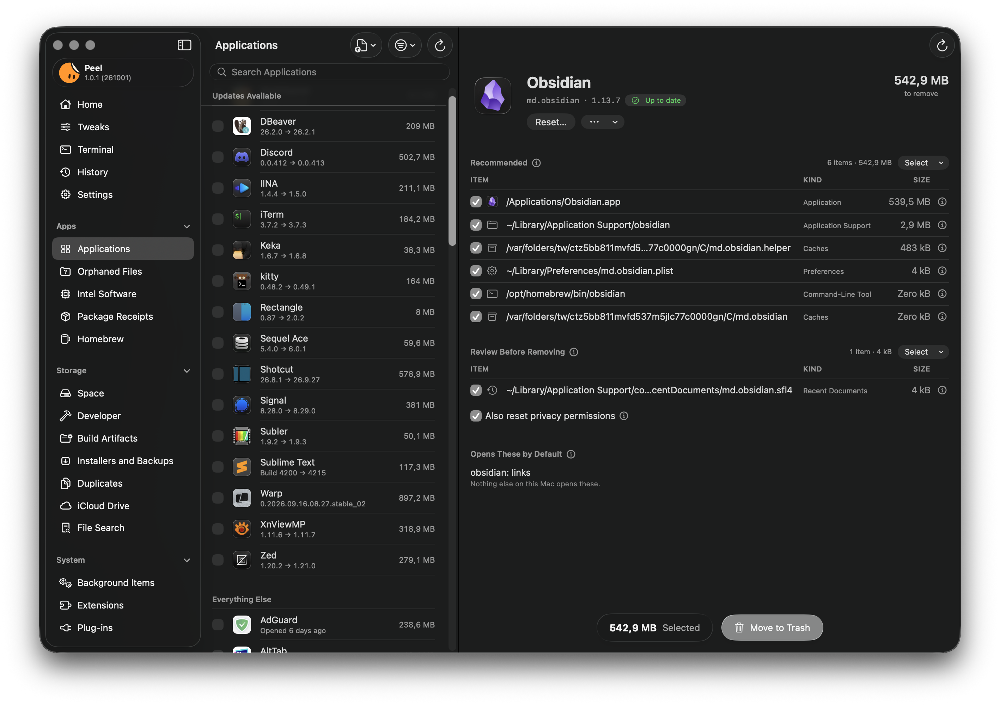
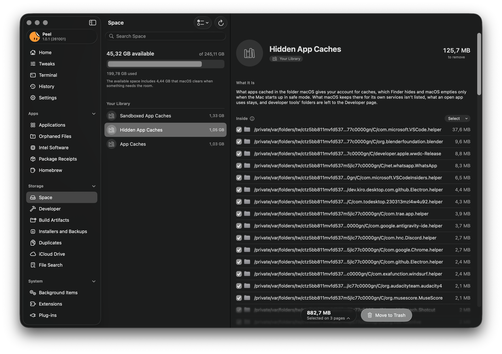
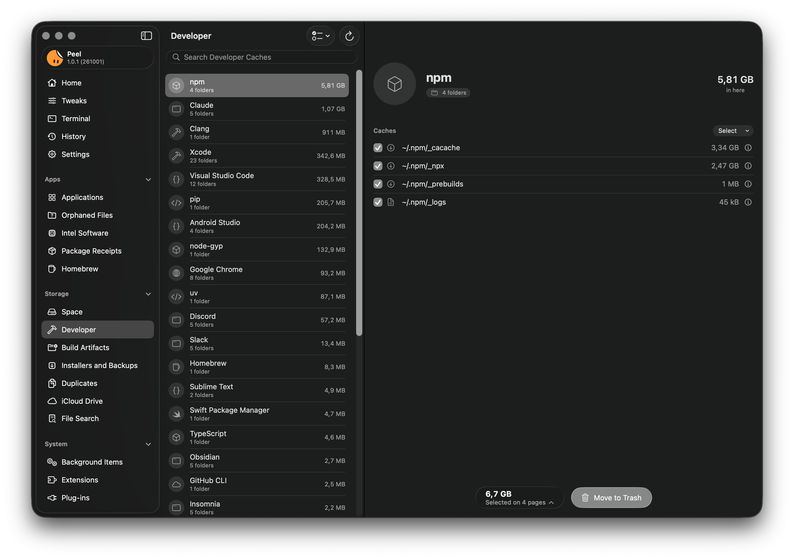
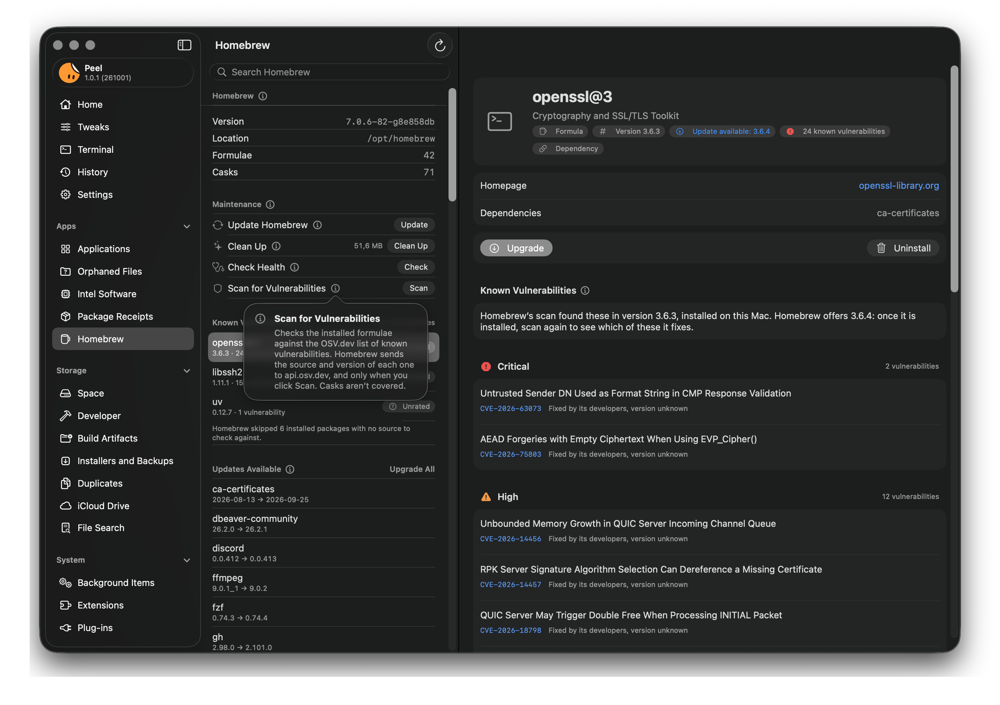
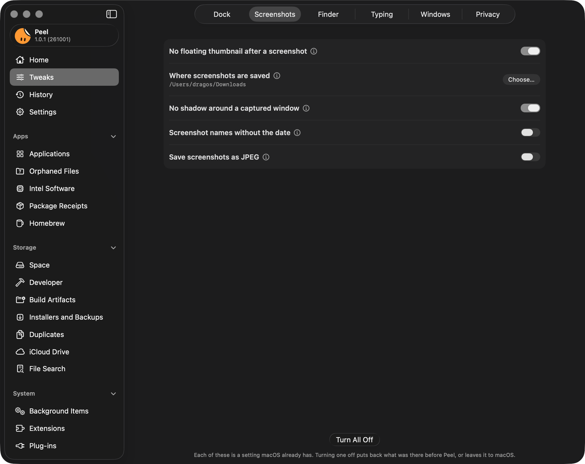
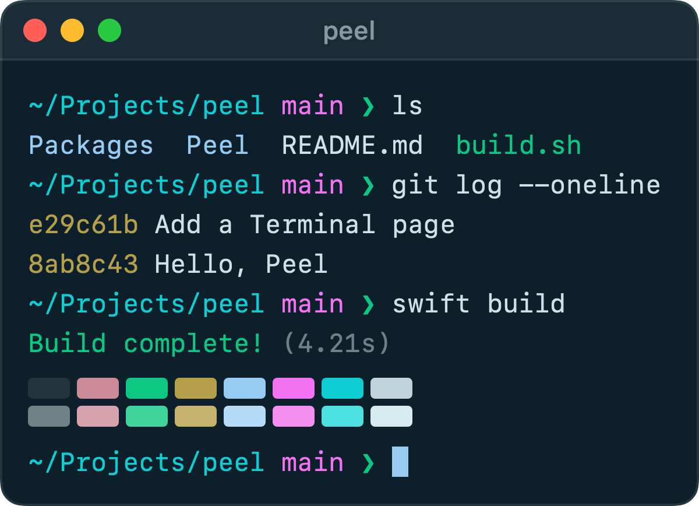
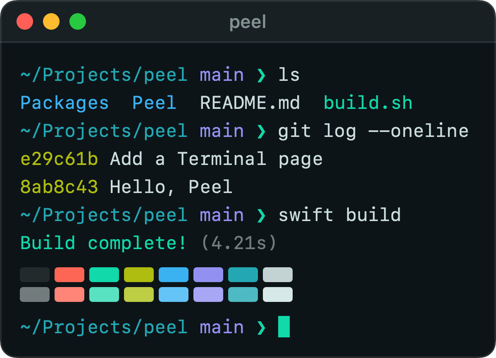
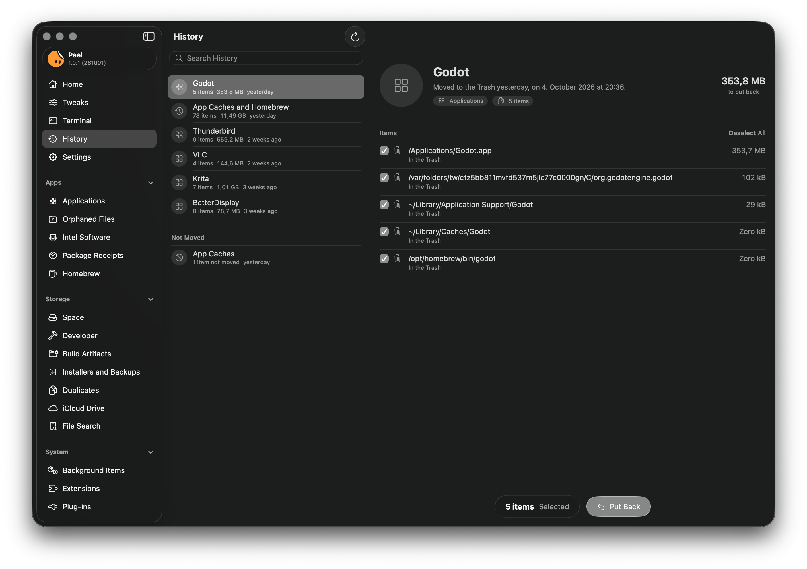
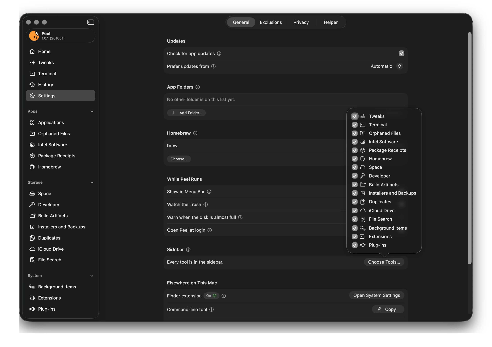
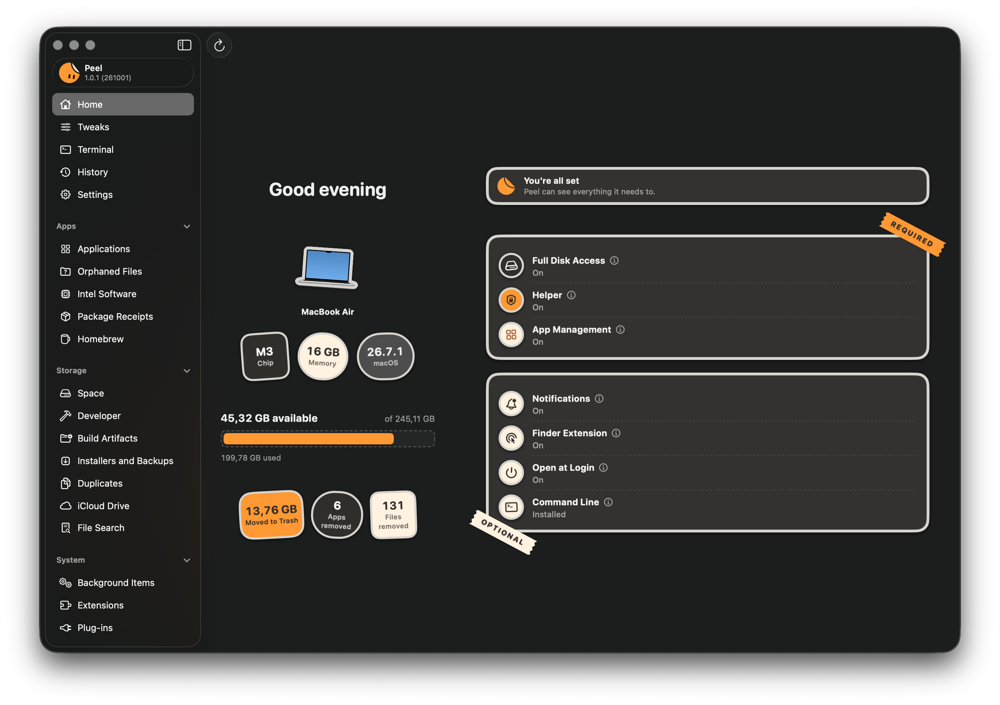

# Using Peel

What each tool in Peel does, what Peel asks for and why, and how to remove it. [README.md](README.md) says what Peel is
and how to get it, [SAFETY.md](SAFETY.md) what it protects, [PRIVACY.md](PRIVACY.md) what it sends, and
[TERMINAL.md](TERMINAL.md) every Terminal theme and setting.

## Uninstall apps completely

<p align="center">
  
</p>

- **Every leftover, with a reason.** Peel searches the places apps keep files: Application Support, caches,
  containers and group containers, preferences, saved state, logs, launch agents and daemons, plug-in folders, and
  more. Each file comes with the reason it matched, such as the app's bundle identifier, its signing team, or a
  Homebrew cask that names it.
- **What Peel is sure of, or nearly, is selected.** Files Peel matched by the app's identifier, its name, or its
  installer's receipt are selected for you, and so is the folder Homebrew keeps for an app it installed, so that
  Homebrew stops listing the app once it is gone. A match on the name alone is only a guess in your home folder, at
  the top of a Library, or inside another app's folder or one of Apple's, so it waits under Review Before Removing.
  So does a folder named like the app while another installed app's name holds that name, as Epic Games Launcher
  holds Epic: the folder may be that app's.
- **What may exist nowhere else is left to you.** A folder holding a crypto wallet, a signing key, a password
  database, or a repository is shown with its reason and not selected, and so is a place where an app keeps what
  may exist only on this Mac, such as local mail, message history, sign-in codes, VPN connections, a torrent client's
  list of torrents, a game's saves, a database, an app's own backups, or the sign-in a tool saved when you logged in.
  Uninstalling Xcode lists the simulators it made the same way.
- **Shared or guessed, never selected.** A file another installed app also uses is shown but never selected, and a
  folder holding another installed app's own data, such as Xcode's in `~/Library/Developer`, can't be selected at
  all, and neither can anything that syncs to your other devices, an app's container holding your documents, or a
  folder around a photo or music library. What Peel only guesses at, from the start of a name or an identifier the
  app's maker or signing team also uses, waits under Review Before Removing, with what is shared and what Peel held
  back. What is named for another app of the same maker that macOS knows, such as a build Xcode keeps, is that app's
  and isn't listed, and an identifier a tool gives apps whose makers set none, such as Electron's `com.electron.`
  ones, ties no two apps to one maker.
- **What only an administrator can move** stays where it is when Peel's helper isn't allowed to move it from there.
  Once the app is gone, Peel says how many items stayed, and Orphaned Files lists them under Needs an Administrator,
  with how to remove them in Finder.
- **Some apps go another way.** An app that installed a system extension, such as a VPN or a virtual camera, is
  listed with its files and nothing selected: only Finder's move to the Trash asks macOS to remove the extension, so
  its page says to move it there. A security or management agent, or a VPN, whose maker documents an uninstaller of
  its own, such as GlobalProtect, Microsoft Defender, or ExpressVPN, is left to that uninstaller, and its page says
  how. An app that runs
  its own uninstaller once it leaves the Applications folder, such as Mullvad VPN or Citrix Workspace, is moved only
  after Peel tells you what that uninstaller will do. Peel itself goes only with Remove Peel, in Settings > General.
- **Open apps quit first.** Peel asks an app that is open to quit before anything of it moves, and looks again at
  what it left once it has. If the app is still open after 10 seconds, Peel offers Force Quit, which loses what the
  app hasn't saved.
- **The Select menu** has Select Recommended, Select All, and Deselect All. Select All selects everything you can
  select, what Peel holds back included, and asks first when that takes anything Peel doesn't recommend.
- **Several ways in.** Choose an app in the list, drop one on Peel's Dock icon, select several apps at once, or
  Control-click an app in Finder and choose Uninstall with Peel, once the Finder extension is on in System
  Settings. With Watch the Trash on, Peel notices when you drag an app to the Trash yourself and offers to clear
  what it left behind, while Peel is open or in the menu bar, and once it has Full Disk Access. An old copy thrown
  away while another copy of the app is still installed brings no such offer, since nothing was left behind. Apps
  you keep outside the Applications folders, such as on another disk, join the list once you add their folder in
  Settings > General > App Folders.
- **Reset instead of remove.** Reset, on an app's page, clears its settings without uninstalling it, and never
  selects your own work. Peel saves a copy of the settings first: put them back from the Reset sheet right away, or
  later from Settings > General > Saved Settings, which keeps each copy until you move it to the Trash, since a copy
  can hold a license key or an account.
- **Privacy permissions too, if you want.** Peel can also reset the permissions macOS gave the app, such as access
  to the camera and the microphone. History can't undo this: the app asks again for each one.
- **Its Dock icon too.** Peel takes the app's icon out of the Dock, where it would stay as a question mark,
  unless you deselect it, and History puts it back where it was when you put the app back.
- **When macOS needs more.** After a removal, Peel says when macOS keeps using what moved: an audio driver until
  you restart your Mac, and, on macOS 27, an app's login items, which macOS starts from the Trash until you empty it.
- **Lines that still point to what moved.** After a removal, Peel reads the files your shell runs when it starts
  (`.zshrc` and the others zsh, bash, and fish read) and names each line that still points to what moved, such as a
  `PATH` entry or an alias into the app, so a new shell stops printing an error once you edit it. Peel changes none
  of these files.
- **What it opens.** An app's page lists the kinds of files and links it opens by default, and what would open
  them once it's gone. Peel never changes that itself.
- **Updates for your apps.** Peel checks your apps for new versions, through the update feed each app names, the App
  Store for apps bought there, iPhone and iPad apps on the Mac included, or Homebrew for apps it installed, in the order
  Prefer updates from in Settings > General sets, and shows what is new in the version that waits, as the app's own
  notes say it, even with no connection. Apps that came with macOS are left to Software Update, and apps from Setapp
  to Setapp, which keep them current. What Homebrew says counts for a day after it last checked for new versions, the
  time Homebrew itself waits before it checks again. Past that, an app only Homebrew can answer for reads Can't check
  for updates until Homebrew checks again, with Update Homebrew on the Homebrew page or `brew update` in Terminal, and
  Peel reads Homebrew again once it has. Rescan in Applications asks about every app again at once. Skip This Version
  and Never Check This App keep it quiet about the ones you want left alone, and Settings > General lists them under
  Muted Updates, where Check Again brings their updates back. Turning off Check for app updates there stops the checks.

## Free up disk space

<p align="center">
  
</p>

Space shows what fills your disk, area by area, and what each area is.

- **Orphaned Files:** files left behind by apps you already removed. Each group is tied to its app by the app's
  identifier, by a folder a code editor or a JetBrains IDE named for its data, by the name of an app Peel saw
  installed and then saw go, or, for the copy macOS keeps of a system extension, by the app macOS's own record
  names. It also lists the files browsers keep to start a helper program that is gone. Nothing is selected for you.
  A system extension's copy can't be selected, since only macOS removes it, and its row says how. Peel doesn't list
  what only a guess could tie to an app, so look for it yourself: a folder named only for a maker, such as `Google`
  in Application Support, a data folder only the app's documentation names, such as Tor Browser's `TorBrowser-Data`,
  a folder named like a gone app while another installed app's name holds that name, such as one called Epic beside
  Epic Games Launcher, and a hidden folder in your home named like an app, since one such as `~/.local` is shared by
  many command-line tools. What only an administrator can move, from a place Peel's helper isn't allowed to move it
  from, is listed apart under Needs an Administrator, with how to remove it in Finder, and so is what an uninstall
  left there, which nothing else would tie to the app once it is gone.
- **Developer:** caches of developer tools, editors, browsers, and AI models. Nothing is selected for you, and Select
  Recommended passes by what you may want again; toolchains or anything holding an account are never listed.
- **Build Artifacts:** what builds left in your projects, like `node_modules`, `DerivedData`, or `target`, each only
  when its tool's own file proves it. Nothing is selected for you, and Select Recommended passes by a project
  changed in the last 7 days.
- **Duplicates:** files and whole folders with identical contents, compared with SHA-256. Unless you choose folders,
  it looks in Desktop, Documents, Downloads, Pictures, Movies, and Music. Files under 100 KB, and folders holding
  less, are left out unless you choose a smaller size, in the app and in `peel duplicates` alike. Copies whose
  Finder tags, Finder comment, or resource fork differ aren't duplicates, since moving one would lose them. After a
  scan you start, Peel selects every copy in each group but the first, which it suggests keeping, so look before you
  move them: one copy is always kept. A copy in a folder that syncs to your other devices, such as iCloud Drive or
  what Desktop and Documents hold when they are in iCloud, is listed and never moved, since the Trash would take it
  from your other devices too: beside a copy on this Mac it is marked Stays, and a group whose every copy syncs is
  listed under Synced to Other Devices. A chosen folder Peel doesn't scan, such as a repository, is named with why,
  in Scan Settings and with the result.
- **Installers and Backups:** disk images and packages in Downloads, Desktop, Documents, Public, and Shared, and in
  the folders directly inside them, where installers are usually left, with archives there that hold an app or an
  installer. It also lists packages an app keeps in Application Support, macOS installers, device firmware,
  downloads a browser never finished, and updates apps downloaded and keep until they install them. Your iPhone and
  iPad backups are listed with their size once Peel has Full Disk Access, and never moved. Nothing is selected for
  you, and Select Recommended takes only what you can download again, such as an installed app's installer, any
  installer in Downloads, a macOS installer, or device firmware. It passes by an encrypted disk image, an installer
  elsewhere that is no installed app's, a package an app keeps for itself, a download that changed in the last day,
  an update whose app is open, and anything in Shared, open in a program, or syncing to your other devices. A disk
  image can also be one you made to keep files in, so look before you select it.
- **iCloud Drive:** files already safe in iCloud that are also downloaded to this Mac, as Finder shows them: what is in
  iCloud Drive and each app's documents, never an app's own data. Downloads are listed in the folders Finder shows
  them in, named as Finder names them, the biggest first, and a folder's checkbox selects every file in it; a file
  that would free less than 1 MB isn't listed. Remove Downloads, as in Finder, takes away only the copy on this Mac:
  each file stays in iCloud and downloads again when you open it. A download whose space on disk is shared with
  another copy on this Mac would free nothing, so it isn't listed, and the page says how many there are. The page
  needs Full Disk Access to see what is kept on this Mac.
- **Space:** what fills your disk, area by area, and which app or tool each area belongs to.
- **File Search:** files by name, kind, or size, and by age along with one of them, in your home folder or across
  this Mac, found through Spotlight, up to 2,000 at a time. A file in a Library folder, an app's working data, is
  listed last and never recommended, and one that needs an administrator stays where it is.

<details>
<summary>Developer, Build Artifacts, and Space, in detail</summary>

<br>

**Developer:** the caches of Xcode, package managers, build systems, editors, cloud and virtual machine tools, game
engines, and AI models. It also lists the graphics caches of Chrome, Chromium, Brave, and Opera, the last update
Google's updater downloaded for each of its apps, the web caches of apps built on Electron, such as Slack or Discord,
and the browser profiles a Playwright run left in the temporary folder when it ended early. It never lists what a
browser or an app keeps for you, a profile a browser still has open, a toolchain, or anything holding an account.

Some of what it lists you may want again, so Select Recommended passes it by: Xcode's archives and the symbols it
copied from your devices, model weights, installed packages and the stores your projects load them from, such as
pnpm's and Dart's, what a tool keeps for you to install again (Vagrant boxes, Asset Store packages, Godot's export
templates), an editor's saved state for a project that no longer exists, the build data of an Xcode project opened in
the last week, a folder Peel couldn't measure, a copy of CocoaPods' specs that didn't come from CocoaPods, and a cache
with a wallet, a signing key, or a password database inside. Nothing is selected for you.

**Build Artifacts:** what builds left in the folders you choose, like `node_modules`, `DerivedData`, `target`, `.nuxt`,
`__pycache__`, Unity's `Library`, and any folder its tool tagged as a cache (`CACHEDIR.TAG`), each only when a file of
the tool that makes it proves it. One found with no such file beside it, as Python leaves `__pycache__` in every
package, belongs to the project above it: the nearest folder holding a repository or a project's own file, such as
`pyproject.toml`. Nothing is selected for you, and Select Recommended passes by a project changed in the last 7 days
or whose last change Peel couldn't tell, installed packages (a Python environment, `vendor`, Terraform's
`.terraform`), a folder like `target` whose name says nothing on its own, a Meson build folder, which also keeps the
options its build was set up with, a folder Git tracks files in, such as a `Pods` folder kept in the repository, which
is part of the project, a folder with a repository, a wallet, or a key inside, and one Peel couldn't measure or read.
Until you choose a folder, Peel offers `~/Developer`, `~/Projects`, `~/Code`, or `~/src` when you have one, and adds
it only when you say so. A chosen folder Peel can't search, such as one on a disk that isn't connected, is named at
the top of the page with the reason, never taken for one with nothing built in it. Peel never searches a hidden
folder, a Library, or a folder a tool fills, such as `node_modules`, where apps and tools keep what they install, so
choosing one, or a folder inside one, is refused.

**Space:** what's taking up room, and which app it belongs to. An area smaller than 50 MB isn't listed. What an app
manages itself, such as Xcode's simulators, Docker's disk, Rust's toolchains, or Android's NDK versions, Space
measures and leaves to that tool, with the command that frees it, when there is one, for you to copy into Terminal:
Peel never runs it, since it deletes for good. Once Xcode is gone, the Simulators area says to install it again
before using its settings. In the Library at the top of the disk, Space also lists the caches and logs apps keep for
every account, and the crash reports macOS keeps. Those an administrator owns go through Peel's helper, and what
macOS keeps there for its own services is never listed. In your own Logs, the folder macOS saves crash reports in
stays and only the reports are offered, since macOS can't make that folder again. What macOS keeps for its own
services in your own Caches and Logs is listed, and Select Recommended passes it by. The logs Homebrew's services
write in `/opt/homebrew/var/log` are offered file by file, and the folders they sit in stay, since a service expects
to find the folder it writes in. Where Developer knows part of a folder, Space says how much of it moves here and
opens Developer for the rest. Space also explains the snapshots macOS keeps on the disk, which Peel never removes,
and, on macOS 27, says how much Apple Intelligence may keep on this Mac, by Apple's figure, and how much the AI
models and datasets Developer lists take.

Nothing is selected for you: Select Recommended takes what Peel could measure in an area and nothing holds back. A
cache or a service's log that something wrote to in the last 15 minutes waits for you to select it, since a program
may still be using it, and what an open app is still writing to stays until you quit the app. Peel can also warn
you, with a notification that opens Space, when less than a tenth of your disk is available: turn it on in Settings >
General.

</details>

<p align="center">
  
</p>

Developer shows what each of your developer tools keeps, folder by folder.

What you select on Orphaned Files, Space, Developer, Build Artifacts, Installers and Backups, Duplicates, and File
Search stays selected while you look at the others, and Move to Trash on any of them moves it all at once, as one
entry in History. These pages select nothing for you, but for the copies Duplicates selects after a scan you start. A
page counts once you have opened it, or once the Select menu in a tool's toolbar, which selects on every page the
tool lists, has selected something there, and opens the first of those pages when none is open. The bar at the
foot of the page says how many pages that is, and lists them. Move to Trash asks first, naming the first few pages
and how many items the others hold.

## Look after your Mac

<p align="center">
  
</p>

> [!TIP]
> Not sure what something means? Click the ⓘ next to its name, like the one open above beside Scan for
> Vulnerabilities, for a short explanation in plain words. Next to a file, it tells you why Peel thinks the file
> belongs to the app.

- **Background Items:** launch agents and daemons, and the app that added each one, to start or stop, enable or
  disable, show in Finder, or move to the Trash, through Peel's helper for those that run as root. One whose program
  is gone, or whose command looks unusual, says so. On macOS 27, Remove takes out a job a deleted app left loaded,
  and an item whose app is in the Trash says that macOS starts it from there each time you log in, until you empty
  the Trash.
- **Extensions:** app extensions and system extensions, and the app each one came with, with whether it is on and
  the place in System Settings that turns it on or off.
- **Plug-ins:** plug-ins of every kind, from audio units to Quick Look, each of which you can move to the Trash,
  after Peel warns that apps using it may stop working.
- **Package Receipts:** what installer packages other than Apple's put on your Mac, item by item, to move to the
  Trash. Nothing is selected for you, and Select Recommended passes by a folder a package made that now holds what
  something else put there. Forget Receipt moves the receipt itself to the Trash, through Peel's helper, so macOS no
  longer counts the package as installed. An app a package installed follows the rules of its own page: one whose
  system extension macOS installed is left for you to move in Finder.
- **Intel Software:** what still needs Rosetta, which macOS 27 is the last release to offer for most Intel software:
  apps, the Intel-only parts inside other apps, plug-ins, drivers, background items, and the commands in
  `/usr/local`.
- **Homebrew:** your formulae and casks, with Update, Clean Up (and two deeper ones: downloads older than 30 days,
  or every download), Repair Taps, Check Health, Scan for Vulnerabilities, Upgrade, and Uninstall, or the command to
  run in Terminal for a cask that asks for an administrator's password. Uninstall and the cleanups delete for good,
  as Homebrew does, and Peel says so before you confirm them. For a cask whose app Peel leaves alone on the app's own
  page, such as one with a system extension, and for a package you excluded, Uninstall stays off, with the reason
  beside it. A cask Homebrew still lists though what it installed is gone, its app or, for a cask with no app, its
  packages, can't be upgraded. It is listed apart under Apps Already Gone, where Forget Cask, or Forget All for every
  one of them, moves Homebrew's record of it to the Trash, with the links Homebrew made into it, so Homebrew stops
  listing it, and History can put it back.

## Fine-tune your Mac

<p align="center">
  
</p>

Small tricks that make everyday life on a Mac a little easier. Tweaks gathers 40 settings macOS already has,
many of them out of sight, in six groups: Dock, Screenshots, Finder, Typing, Windows, and Privacy. Make a
hidden Dock appear at once, save screenshots where you want them and without the floating thumbnail, show
hidden files and every file extension in Finder, keep straight quotes as you type, drag a window from anywhere
in it, or put seconds on the menu bar clock. Each tweak says what it changes, and turning it off puts back what
was there before, or leaves it to macOS. Turn All Off puts back everything Peel changed and leaves what you set
yourself as it is. On macOS 27, Privacy also has an Apple Intelligence section: each row opens the place where Apple
says to turn that feature off, in System Settings or in the app, and Peel changes none of them.

## Set up Terminal

<p align="center">
  
  
</p>

Peel comes with 29 dark themes for Terminal, built on Apple's own Clear Dark. Choose one, and Terminal opens with it
in every new window; Put Back gives Terminal the profiles it used before. The same page can leave out the "Last
login" line, keep Terminal from reopening its windows, make Option the Meta key and silence the bell in a Peel theme,
and show the line that stops the shell from saving its sessions.

It sets up the command line as well:

- **A prompt** you put together, with a preview, or the one macOS sets.
- **Settings zsh, Git, and ssh already have**, each with a switch: a longer history shared between windows, Up and
  Down that find what you started typing, Tab completion with a menu, rebase when pulling, and connections that stay
  alive.
- **Nothing written into your own files.** Peel writes the zsh and ssh settings to files of its own, which zsh reads
  through one line you add and ssh through two, and changes Git's with `git config`. Turning a Git setting off puts
  back what you had before Peel set it, and one you set yourself goes back to Git's default. Turn All Off undoes
  what Peel set on each tab, and on the Git tab also what you set yourself.
- **Tools** suggests command-line tools worth having, with the Homebrew command and the lines to add.

[TERMINAL.md](TERMINAL.md) shows every theme and every setting, with what each one writes.

## Stay in control

<p align="center">
  
</p>

- **History:** everything Peel moved to the Trash, ready to put back, from the app and from Terminal alike, and
  what it was asked to move and wouldn't, with the reason for each item. It puts back what is still in the Trash
  and keeps the latest 20,000 items, and Undo in the Edit menu puts back the last removal.
- **Exclusions:** files, folders, and apps Peel must never touch. An excluded app still appears in Applications, but
  Peel won't offer to remove or reset it, and leaves out of every page the folders named with its identifier, such as
  its caches; to keep its other files, such as plug-ins or a folder named after it, exclude them too. Add them in
  Settings > Exclusions, or Control-click a row and choose Exclude from Peel. In Orphaned Files, Control-click a
  group and choose This Belongs To, and Peel stops listing it while the app you chose is installed.

## Work your way

<p align="center">
  
</p>

Settings > General holds Peel's choices, among them which tools the sidebar shows. Settings also has Exclusions,
Privacy, which says what Peel sends and every place it may contact, and Helper.

- **Export List of Apps:** in the File menu and in Applications' toolbar, what's installed and where each app came
  from, as JSON, a spreadsheet, plain text, or, with Homebrew 4.4.25 or later installed, a Brewfile.
- **Shortcuts:** actions that open a page in Peel for you to look at. None of them removes anything.
- **Sidebar:** turn off the tools you don't use in Settings, and they leave the sidebar. The View menu and
  Shortcuts still open them. Home, Applications, and History always stay. Background Items, Extensions, Plug-ins,
  Build Artifacts, Intel Software, and Terminal start turned off, and Homebrew starts on only when Homebrew is
  installed; what you turn on or off stays so.
- **The `peel` command:** most of what Peel does, from Terminal, as [The `peel` command](#the-peel-command) says.

With Show in Menu Bar on, Peel's menu bar item lists what each tool found the last time it looked, a line per tool
that opens it in Peel. It never adds them up into one figure and never selects anything for you.

## The `peel` command

- **Getting it.** The command ships inside Peel. Settings > General shows, beside Command-line tool, the command
  that puts it on your path: copy it and run it in Terminal, which asks for your password. A Homebrew install puts
  it there for you.
- **It asks first.** Every command that moves something shows its plan and asks before it moves anything.
  `--dry-run` only shows the plan, and `-y` skips the question.
- **Only when you can answer.** It asks only in a terminal where you can see the plan and type, so with its output
  sent to a file or a pipe it needs `-y`. It ignores keys typed before the question appeared, and answering no
  exits with code 2, so `peel uninstall Foo && next-step` stops there.
- **What the app would do.** It moves only what the app would suggest, or a group of orphaned files you name with
  `peel orphans --remove`, through the same checks and into the same History. Anything that needs an administrator
  is left to the app, and the command won't run under `sudo`.
- **For scripts and agents.** `apps`, `leftovers`, `orphans`, `caches`, `projects`, `duplicates`, `search`, `history`,
  and `updates` take `--json`, which lists and never moves, so `--json` with `--remove` is refused rather than guessed
  at, and `uninstall --json` reports once the move is done: each item and why it stays, what moved, what failed and
  why, whether the privacy reset happened, the folders Peel couldn't read, and the lines of your shell files that
  still name what moved. A size nobody knows is `null`, never zero, and what a scan couldn't read is said on
  standard error too. The exit status says how it ended: 0 when it did what was asked, 1 when something failed or
  stayed where it was, 2 when you answered no, and 64 when the command is wrong or it would have to ask and can't.
- **Completions and manual.** A Homebrew install sets up its completions for zsh, bash, and fish, and its manual
  page, `man peel`. Otherwise `peel --generate-completion-script zsh` (or `bash`, or `fish`) writes the
  completions for your shell, and `man /Applications/Peel.app/Contents/Resources/man/peel.1` shows the manual page.

## What Peel asks for, and why

<p align="center">
  
</p>

Peel opens without any of these and does more with each one. Home, in the picture above, shows which ones are on
and takes you straight to the right place in System Settings, or, for the command line, in Peel's Settings.

| Permission | What it lets Peel do |
|---|---|
| Full Disk Access | Look inside the Trash and the private folders where apps keep their data. Without it, Peel can't find everything an app leaves behind. Watch the Trash, the iCloud Drive page, and the list of iPhone and iPad backups need it too. |
| App Management | Move another developer's app to the Trash. Without it, Peel can still clear an app's files, but macOS may refuse to move the app itself. |
| Helper | Move to the Trash, and put back, what sits in folders only an administrator can change, such as an app's leftovers, the caches and logs Space lists for every account, and an installer package's files and receipt, and start, stop, enable, or disable other developers' background items that run as root. It answers administrators only. macOS asks you to approve it once in Login Items & Extensions, and an update of Peel brings its new helper with it. |
| Notifications (optional) | Tell you when your apps have updates, when Homebrew finishes an upgrade or runs into a problem, when your disk is almost full if you turn that warning on, and, with Watch the Trash on, when you move an app to the Trash yourself. |
| Folders macOS asks about | Without Full Disk Access, macOS asks the first time Peel looks in Desktop, Documents, or Downloads for installers, duplicates, and what builds left, or at your cloud folders to measure them. On macOS 26 it also asks before Peel looks inside another app's data for what it would leave behind; on macOS 27 it refuses without asking, and Peel says which folders it couldn't read. |
| Finder Extension (optional) | Add Uninstall with Peel to the menu you get when you Control-click an app in Finder. |
| Open at Login (optional) | Start Peel when you log in. With Show in Menu Bar on, it keeps running after you close its window, so Watch the Trash keeps working. |
| Command Line (optional) | Use `peel` from anywhere in Terminal. Home's Copy button, like Settings > General, copies the command that puts it on your path, and Terminal asks for your password when you run it. |

Install the helper from Home, or with Install Helper in Settings > Helper, from an administrator's account, then allow
it in System Settings > General > Login Items & Extensions. If Home says the helper isn't answering, choose Repair
there, or Repair Helper in Settings > Helper. If it keeps waiting for approval, the questions in
[README.md](README.md#frequently-asked-questions) say what to do.

## Languages

Peel is in English and translated into 17 languages: Romanian, German, French, Spanish, Portuguese (Brazilian),
Italian, Japanese, Chinese (Simplified), Chinese (Traditional), Dutch, Korean, Russian, Polish, Turkish, Swedish,
Czech, and Ukrainian. It uses the first language in your Mac's list that it speaks, and English for any other. Each
translation uses the words macOS itself uses in that language.

To use Peel in a language other than your Mac's, open System Settings > General > Language & Region, click the Add
button under Applications, choose Peel and a language, then click Add. If Peel is open, quit it and open it again.
The `peel` command stays in English, since scripts read it.

## Uninstall Peel

In Settings > General, choose Remove Peel. Peel then:

- moves the link to the `peel` command to the Trash, if you made one with the command Settings gives, through its
  helper when only an administrator can, and has the helper move its own record of what it moved;
- removes its helper and its login item;
- moves itself, the files that are certainly its own, and its folder in Application Support to the Trash, all but
  the Terminal settings zsh and ssh read. That folder holds History, your exclusions, and the settings Peel saved
  when you reset an app;
- ends its Finder extension, takes its icon out of the Dock, clears its settings, and quits.

Remove Peel takes no step while Peel itself can't move, such as from a folder only an administrator can change, and
while its helper is installed, only an administrator's account can remove it, so from another account Peel stays
where it is.

If you dragged Peel to the Trash instead, its helper stays registered: System Settings > General > Login Items &
Extensions still lists Peel among the apps with background activity. Put Peel back from the Trash in Finder, open it,
and choose Remove Peel.

After Remove Peel, what Peel changed for you stays as it is: tweaks, Terminal's theme and its options, the shell and
ssh settings, `~/.hushlogin`, Git's settings, the build folders you left out of Time Machine, and the background items
you disabled. Peel leaves the shell and ssh settings in its folder, in `Terminal`, where the line you added to
`~/.zshrc` and the two at the end of `~/.ssh/config` read them. Turn these off first if you want them gone, or
afterward delete those lines and that folder.

If you installed Peel with Homebrew, Settings shows this command in its place, with a button that copies it. Run it
in Terminal: Homebrew takes Peel off its list of what is installed, deletes the app rather than moving it to the
Trash, deletes the helper's record of what it moved, and moves Peel's other files to the Trash, its whole folder in
Application Support included. The Terminal settings zsh and ssh read go with that folder, so the line in `~/.zshrc`
and the two in `~/.ssh/config` then read nothing: turn those settings off in Peel first, or delete those lines
afterward.

```bash
brew uninstall --zap --cask peel
```

When only an administrator can remove the link to the `peel` command you made with the command Settings gives, and
Peel's helper isn't installed, Remove Peel leaves the link, and Settings says so beforehand. When the helper is
installed but doesn't answer, Remove Peel leaves the link and the helper's record of what it moved, and names both
once it is done. `brew uninstall` removes only the link Homebrew made. Remove a link that stays yourself:

```bash
sudo rm -f /usr/local/bin/peel
```

## Questions

### Why does Peel show a smaller size than Finder?

Peel shows what moving an item to the Trash would free, and Finder shows the space it takes. The two differ when
files share their space: a copy Finder makes on an APFS disk shares its blocks with the original until one of them
changes, and a file can have a second name somewhere else, which keeps it. Peel counts only what would really go.

### Why does Peel ask for Full Disk Access?

macOS keeps other apps' data, and the Trash, out of sight of any app without it. Peel works without it, but can't
see everything an app leaves behind. [PRIVACY.md](PRIVACY.md) lists the only times Peel goes online.

### Is Peel really free?

Yes. Peel is free and open source under the GNU General Public License, with no paid edition, no ads, and no
account.

### How does Peel update itself?

Choose Check for Updates in the Peel menu, or Install Update in About Peel when it says a new version is out. While
Check for app updates is on, Peel also looks once a day. It shows what is new and installs the update only when you
choose, once it has checked that the update is signed as Peel's.

### Something in Peel isn't clear. Where can I read more?

Click the ⓘ next to its name. If it's still not clear,
[open an issue](https://github.com/TuguiDragos/Peel/issues/new/choose): wording that leaves you guessing is a bug
too.
