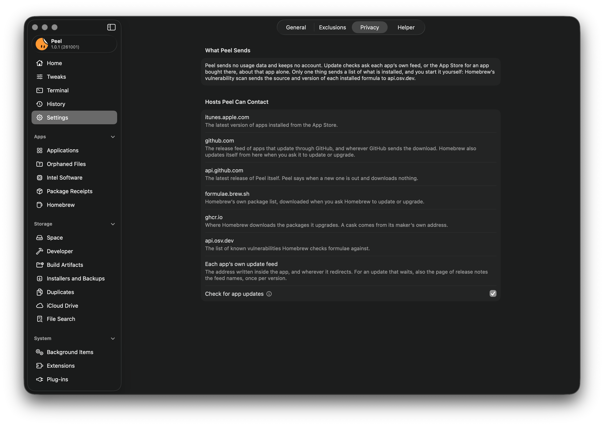

# Privacy

  

Settings > Privacy shows what Peel sends and every address it or Homebrew may contact.

Peel sends no analytics and has no account. On its own, it goes online only to check your apps, and itself, for
updates, and you can turn that off.

Each check asks one app's own update feed about that app alone, or the App Store about an app from the App Store. It
says only that Peel is asking, and tells the App Store a country, since its answer depends on it: the country of the
store an iPhone or iPad app came from, as the App Store notes beside the app, or else your Mac's region. It sends no
version, of the app or of Peel, and nothing about your macOS or your languages. Every check uses HTTPS, and a feed that
sends it elsewhere is followed only to another HTTPS address. Each check asks about one app, but taken together, the
checks show the App Store which of its apps you have, and GitHub which of your apps update through it.

For an update that waits, Peel also reads the page of release notes the app's feed names, and the app's own feed when
Homebrew found the update, once per version (again hours later only when its server didn't answer), and keeps the notes
so they show with no connection. When the feed names a page of notes for each language, Peel asks for the one in your
language, so the server that keeps those pages can tell which language you read. Nothing in them is loaded or run: Peel
shows their text, and a link in them opens only when you click it.

Homebrew goes online only when you ask it to: to update, to upgrade, to repair its taps, which asks each tap's
repository whether its main branch was renamed, or to scan for vulnerabilities. That scan, which Homebrew runs as
`brew vulns`, is the one time a list of what is installed leaves your Mac all at once: for each formula it checks,
where its code comes from (the address of its source repository and the release tag, or a package's name) and its
version, sent to `api.osv.dev`. Peel runs Homebrew with its analytics turned off. Your own Homebrew settings (a
`brew.env` file) can change what Homebrew does, analytics included, and the Homebrew page then says what they change.

Peel checks for its own updates with Sparkle: it reads Peel's signed feed on GitHub over HTTPS, saying only that Peel
is asking, and downloads a new version only when you choose to install it, then checks that it is signed as Peel's
before installing it.

Turn off Check for app updates in Settings, and Peel contacts nothing on its own. Check for Updates in the Peel menu
still asks about Peel when you choose it, and the `peel updates` command still checks whenever you run it, whatever
that switch says.

Report an Issue, in the Help menu, opens GitHub's form for a new issue with Peel's version, your macOS version, and
whether your Mac has Apple silicon or Intel already filled in. They are in the address the browser opens, so GitHub sees
them as the page loads, and they are posted only if you send the issue.

## Every address Peel or Homebrew may contact

| Address | Why |
|---|---|
| `itunes.apple.com` | The latest version of an app from the App Store. No other app is ever asked about. |
| `github.com` | Peel's own update feed, release feeds of apps that update through GitHub, and wherever GitHub sends the download. Homebrew also updates itself and its taps from here when you ask it to, Repair Taps included, and a tap you added from another address from there. |
| `api.github.com` | When you ask Homebrew to update or upgrade, it first asks here whether Homebrew itself, and each tap kept on GitHub, has changed. |
| `formulae.brew.sh` | Homebrew's list of packages, when you ask Homebrew to update or upgrade. |
| `ghcr.io` | Where Homebrew downloads the packages it upgrades, and wherever it redirects. A package with no ready-made build for your Mac downloads its source from the address its formula names, and a cask comes from its maker's own address. |
| `api.osv.dev` | The database of known vulnerabilities that Homebrew's scan checks your formulae against. |
| Each app's own update feed | The address written inside the app, such as a Sparkle feed, and wherever it redirects. For an update that waits, also the page of release notes the feed names, once per version, and again hours later when its server didn't answer. |
