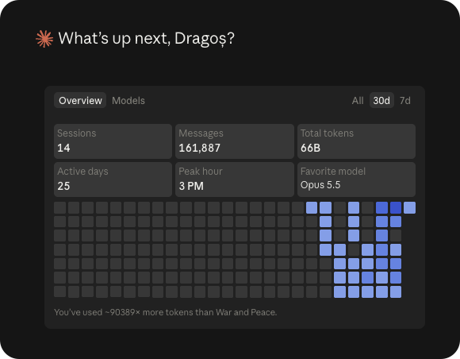

# How Peel was made

I made Peel in three weeks, from September 18 to October 8, 2026, with Claude Code, on two accounts with the Max 20x
plan. The rules it was made by are now in [AGENTS.md](../AGENTS.md): prove a problem on a Mac before changing
anything, write a test that fails first, and check the result where it shows.

  

The picture is Claude Code's own overview of my last 30 days, most of it spent on Peel: 14 sessions, 161,887
messages, and 66 billion tokens over 25 active days, with Opus 5.5 as the favorite model.

- **Time:** three weeks, September 18 to October 8, 2026.
- **Commits:** 1,708: 764 before this repository started again on September 24, and 944 in it, this page the last
  of them.
- **Code:** 97,169 lines of Swift in 616 files.
- **Tests:** 1,872 in the package's suite, in 181 files.
- **Languages:** English and 17 others.

## A month later

I wrote the part above on October 8, the day Peel 1.0.1 came out. On October 28, under
[my LinkedIn post](https://www.linkedin.com/posts/tuguidragos_i-need-your-opinion-i-just-released-ugcPost-7514068807515103232-Stz0/),
Lutz Hühnken said that it takes a lot of trust to let an app clean your Mac. He asked if Claude coded most of Peel,
and whether I could write more about how I make it. I said I would.

He was right: Claude wrote almost all of the code, and some people call Peel AI slop because of it. I understand why.
My part was deciding what Peel should do and testing it by hand, and most of that does not show in the repository.

I built Peel for myself first. I had read too many stories of people who lost important files, so Peel moves what it
removes to the Trash, and History can put it back. If something cannot be undone, Peel says so before it starts. To
decide whose a file is, it looks at what can prove it: the identifier of the app, the team that signed it, the helpers
inside it, the receipt from its installer, and the list Homebrew keeps. A file that another app also uses is never
selected for you, and the files Peel is not sure about wait for you to check them.

### Most rules came from a mistake

Code can pass its tests and still be wrong. Each time I caught Claude cutting a corner, I turned the lesson into a
rule, and most of the rules at the top of this page came that way. On October 11 I added one more: before anything
goes up to GitHub, Claude reads every commit again, one by one, and writes down what it finds. A second reading had
just found 7 problems in 37 commits that all passed their tests, and one of them had made Watch the Trash go silent
for every app Peel listed. Those readings have caught dozens more since then.

I also asked Claude to audit Peel the way a stranger would, one session per page, reading only: nineteen sessions on
October 25 and twenty-four on October 31. They found 378 problems and observations, then 255, and we fixed each one or
closed it with a reason.

### I tested Peel on real apps

Peel has to know which files belong to an app, so I watch what apps leave behind. I install an app, use it, remove it
the way its maker says to, and compare what stays with what Peel finds. On November 8 alone I did that with eight
apps: NoMachine, Avast, AVG, Tuxera NTFS, Trend Micro, Background Music, Grammarly, and Privileges from SAP. Since
September 18 that comes to more than 200 apps and well over 600 hours of work.

Privileges keeps a security extension inside a helper app. While that extension runs, macOS refuses to move the app,
even from Finder or with the uninstall script that comes with Privileges, so Peel now tells you to turn the extension
off in System Settings first. The first time I tried it, the page in Peel did not notice the change when I came back,
and Claude had to fix that too.

My Mac runs macOS 26, and Peel has to work on macOS 27 too, so I test on my Mac and in a virtual machine with macOS 27.
A change to how Peel looks on 27 stays on 27. A bug that shows up on both gets fixed on both, and I compare screenshots
from before and after.

### Some bugs only showed up when I used Peel

In Background Items, Load started an AdGuard service that I had turned off in System Settings, and in 1.2.0 a picture
on Home looked blurry. We traced both to their cause and added tests so they stay fixed.

Five people opened issues on GitHub. I answered each one, and the ones that were bugs in Peel got fixed, most of them
within a day or two. Someone also sent me a private report: the privileged helper, which moves files that need an
administrator, could be made to move a different file than the one it had checked. We fixed it the same evening and
shipped the fix in 1.3.0 that night, after testing it in the virtual machine.

So far no one has told me that Peel took something they needed. That matters most to me, because I am the most
paranoid person I know about my files.

By November 8 Peel had five releases, from 1.0.1 to 1.3.0, a little over 5,000 downloads, and about a thousand
requests a day to its update feed. Since October 26 you can also install it from the official Homebrew casks with
`brew install --cask peel`.

The numbers from the list above, a month later:

| | October 8 | November 8 |
| --- | --- | --- |
| Commits on GitHub | 944 | 2,559 |
| Lines of Swift | 97,169 in 616 files | 159,495 in 874 files |
| Tests | 1,872 in the package | 3,147 in the package and 325 inside the app |

If Peel gets something wrong on your Mac, please open an issue. I read every one.
